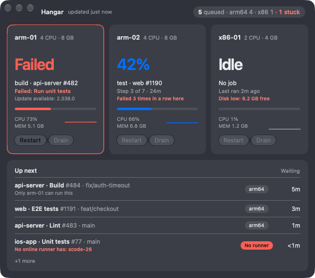
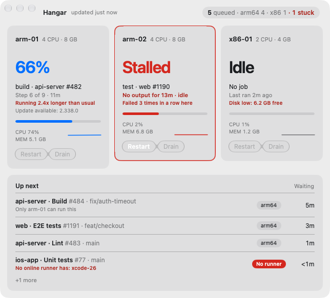
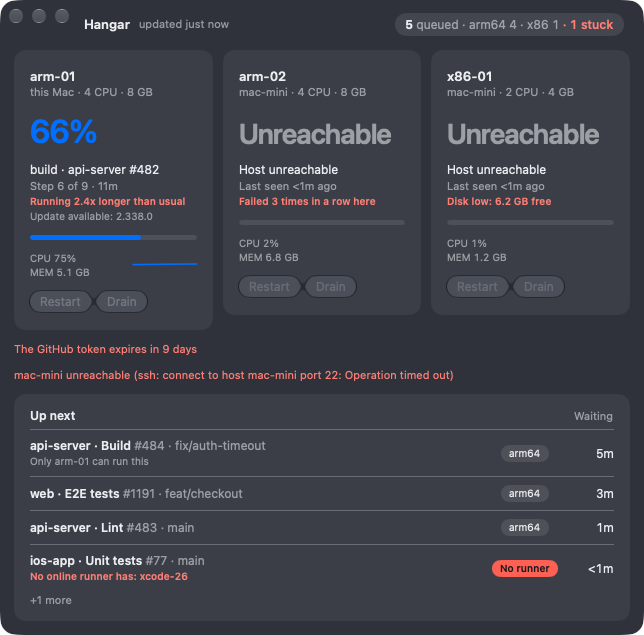
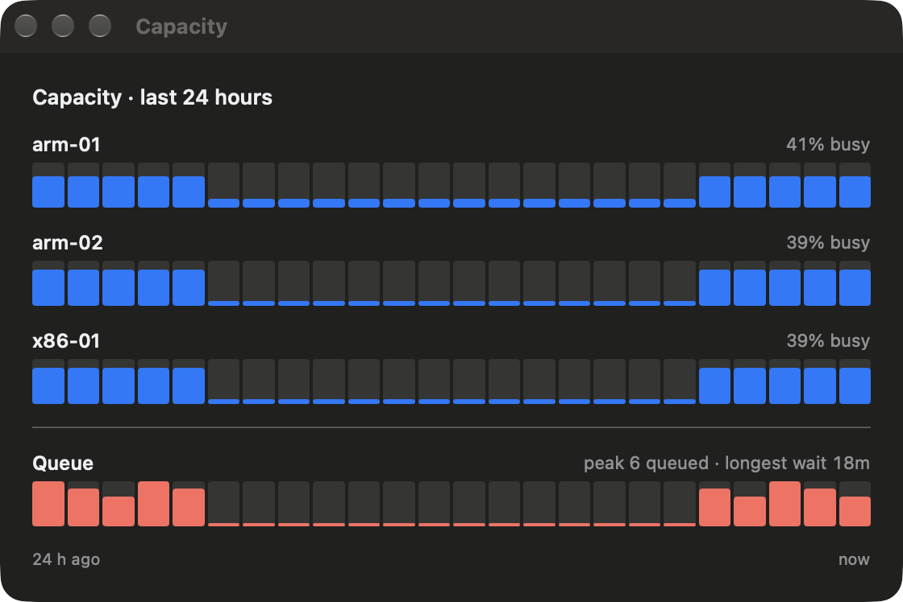

<p align="center"></p>

# Hangar

A small macOS app (SwiftUI, Liquid Glass, macOS 26+) that shows the state of self-hosted GitHub Actions runners running in Colima VMs: runner and VM health, current job and step progress, CPU and memory load, stalls and failures, and the shared job queue. Stalls and failures raise a macOS notification. Each runner can be restarted or drained from the window.

<p align="center">
  
  
</p>
<p align="center">
  
  
</p>

Screenshots use the built-in demo data (`Hangar --demo`), not a real setup.

## Features

- Per-runner cards for every runner found on this Mac, other Macs over SSH, and inside Colima VMs: state, job, step progress, CPU and memory.
- Stalls are flagged only when the log is silent **and** the runner's own processes are idle; failures name the failed step and link to the job on GitHub.
- The queue shows how long each job has waited and flags jobs that no online runner can take.
- Notifications for stalls, failures and unexpected outages; a Dock badge counts runners that need attention.
- Unreachable hosts stay visible, greyed out; a warning appears before the GitHub token expires.
- Capacity window (Window ▸ Capacity, ⌥⌘C): 24-hour history of runner use and queue length, stored locally for 8 days.
- Optional launch at login.

## Build

Requires Xcode 26+, [XcodeGen](https://github.com/yonaskolb/XcodeGen) and [Colima](https://github.com/abiosoft/colima).

```bash
cp Local.xcconfig.example Local.xcconfig   # then set your bundle id / team (file is gitignored)
xcodegen generate
open Hangar.xcodeproj
```

The app is not sandboxed because it runs the `colima` CLI.

## Configure

Open Settings (⌘,): GitHub org or user, repos, Colima profile names (one per runner), runner directory inside the VM, stall threshold and poll interval.

The GitHub token (fine-grained, `actions:read`) is stored in the macOS Keychain only. It is never written to disk, defaults or logs, and nothing secret lives in this repository.

## Demo mode

`Hangar --demo` shows scripted data with no token or VMs. Extra flags: `--scenario-failed`, `--scenario-restarting`, `--scenario-paused`, `--scenario-unreachable`, `--scenario-offline`, and `--light` / `--dark` to force an appearance.

## Tests

```bash
xcodebuild -project Hangar.xcodeproj -scheme Hangar test CODE_SIGNING_ALLOWED=NO
```

## Releasing

`scripts/release.sh` builds a Release, signs it with your Developer ID (hardened runtime), packages a DMG, notarises it, staples the ticket and checks it with Gatekeeper, then prints the SHA-256. It publishes nothing.

One-time setup (the app-specific password stays in your login Keychain, never in the repo):

```bash
xcrun notarytool store-credentials hangar-notary --apple-id <your Apple ID> --team-id <your team ID>
```

Then:

```bash
scripts/release.sh                  # full run, writes build/Hangar-<version>.dmg
scripts/release.sh --skip-notarise  # signed only; Gatekeeper will still warn on other Macs
```

The signing team is read from `HANGAR_TEAM` or from `DEVELOPMENT_TEAM` in your git-ignored `Local.xcconfig`. The version comes from `MARKETING_VERSION` in `project.yml`.

## Licence

Hangar is open source under the [Apache License 2.0](LICENSE). You may use, modify and redistribute it, including commercially, provided that you:

- keep the [LICENSE](LICENSE) and [NOTICE](NOTICE) files, so the original project and its author stay credited in your fork or product;
- mark any files you changed;
- do not use the Hangar name or icon to suggest your version is the original or endorsed by the author.

The licence grants no rights to the Hangar name or icon beyond describing where your work came from.
