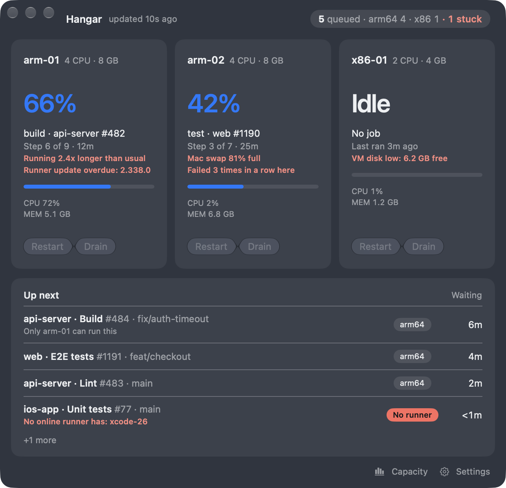
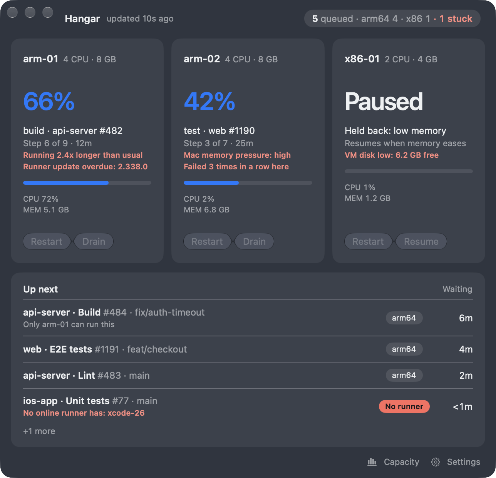

<p align="center"></p>

# Hangar

A small macOS app (SwiftUI, Liquid Glass, macOS 26+) for keeping an eye on self-hosted GitHub Actions runners. It shows every runner on this Mac, on other Macs over SSH, inside Colima VMs, or running natively on macOS, in one glanceable window: what each runner is doing and how far through it is, how loaded and how healthy its machine is, what has stalled or failed, and what is waiting in the shared queue.

It stays quiet when all is well and speaks up when something needs you: stalls, failures, runners that go offline, a Mac running out of memory, a disk filling up, a runner that has fallen behind on updates. Each runner can be restarted or drained (finish the current job, then stop taking new ones) from the window.

<p align="center">
  
  
</p>
<p align="center">
  
  
</p>
<p align="center">
  
  
</p>

Screenshots use the built-in demo data (`Hangar --demo`), not a real setup.

## Install

Download the latest `Hangar.dmg` from the [Releases page](https://github.com/rsutcliffe/Hangar/releases/latest), open it and drag Hangar to Applications. The app is signed and notarised, so it opens without a security warning. Run it from `/Applications`.

On first launch macOS asks for two permissions, and the window explains them: **Notifications**, for alerts, and **Local Network**, so Hangar can reach your other Macs. Allow both. Hangar tells you in its footer when a newer release is available; that check can be switched off in Settings.

## Features

- **A card for every runner**, wherever it lives: this Mac, other Macs over SSH, Colima VMs, native macOS runners. Each shows its state, current job and step progress, CPU and memory. The repositories are discovered from the runners' own configuration, so there is no repository list to keep up to date.
- **Stalls are flagged only when the log is silent *and* the runner's own processes are idle.** Failures name the step that failed and link to the job on GitHub.
- **Notes on a card appear only while they are true:** a job running much longer than that job usually takes; the same job failing again and again (dropped from the window an hour after the last failure); a VM disk running low; a Mac under memory pressure, or with most of its swap in use, which slows a VM without any error inside it; a runner that has not installed a release more than two weeks old.
- **The queue** shows how long each job has waited, which runners can take it, and flags jobs that no online runner can.
- **Notifications that do not flood.** Stalls, failures, outages and restarts that do not come back each notify once. A job that keeps failing sends one notification, not one per failure. What has been announced is remembered across restarts, each kind of alert has a cooldown, and a burst is folded into one summary. Optional quiet hours hold the non-urgent ones. A Dock badge counts runners that need attention.
- **Unreachable hosts stay visible**, greyed out with when they were last seen. A warning appears before the GitHub token expires. A repository the token cannot read is a warning, and everything else keeps updating.
- **Capacity window** (Window ▸ Capacity, ⌥⌘C): 24 hours of use per runner and queue length, plus recent failures with the date, time and step, each linking to the job. History is stored locally.
- **Optional: protect running jobs.** While a Mac reports memory pressure, its idle runners are paused so the job already running can finish; a running job is never touched. Off by default, and it only works while Hangar is open.
- Optional launch at login.

## Configure

Open Settings (⌘,):

- **GitHub token.** A fine-grained token with **Actions: read** and **Administration: read** on every repository that has a runner. Hangar keeps one token for all of them, so a new repository needs adding to it. The token is stored in the macOS Keychain only. It is never written to disk, defaults or logs, and nothing secret lives in this repository.
- **Hosts.** One per line: `local`, or an SSH target such as `you@build-mac.local`. SSH uses your existing key and Hangar never asks for a password. A name that stays put (such as a `.local` name) is more reliable than an IP address that can change.
- **Colima profiles.** The profile names to look in for VMs.
- **General.** Launch at login, the update notice, protect running jobs.
- **Quiet hours, stall threshold and poll interval.** "Test connection" checks the token, hosts and profiles.

Hangar is not sandboxed because it runs the `colima` CLI and `ssh`. On other Macs it expects `colima` under `/opt/homebrew/bin` or `/usr/local/bin`.

## Build

Requires Xcode 26+, [XcodeGen](https://github.com/yonaskolb/XcodeGen) and [Colima](https://github.com/abiosoft/colima).

```bash
cp Local.xcconfig.example Local.xcconfig   # then set your bundle id / team (file is gitignored)
xcodegen generate
open Hangar.xcodeproj
```

## Demo mode

`Hangar --demo` shows scripted data with no token, hosts or VMs. Extra flags: `--scenario-failed`, `--scenario-restarting`, `--scenario-paused`, `--scenario-unreachable`, `--scenario-offline`, `--scenario-permission`, `--scenario-pressure` (add `-protectJobs YES` to see a runner held back), `--welcome`, and `--light` / `--dark` to force an appearance.

## Tests

```bash
xcodebuild -project Hangar.xcodeproj -scheme Hangar test CODE_SIGNING_ALLOWED=NO
```

## Releasing

`scripts/release.sh` builds, signs, notarises and verifies a DMG, and can attach it to a GitHub release. Setup and steps are in [docs/releasing.md](docs/releasing.md); release notes live in [docs/CHANGELOG.md](docs/CHANGELOG.md).

## Licence

Hangar is open source under the [Apache License 2.0](LICENSE). You may use, modify and redistribute it, including commercially, provided that you:

- keep the [LICENSE](LICENSE) and [NOTICE](NOTICE) files, so the original project and its author stay credited in your fork or product;
- mark any files you changed;
- do not use the Hangar name or icon to suggest your version is the original or endorsed by the author.

The licence grants no rights to the Hangar name or icon beyond describing where your work came from.
